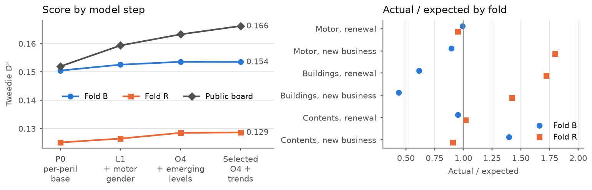
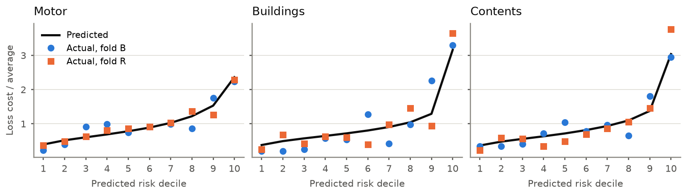

# Pricing a new market with an AI-assisted actuarial workflow

IAA AI-Assisted Hackathon 2026. Team "The KMR", a solo entry by a Fellow of the CIA. Report v2,
28 October 2026. Every number comes from the submitted repository; file paths are given
where a reader may want the detail.

## 1. Summary

**The task.** The insurer is expanding from a developed market into an emerging one. We
predict the risk premium for every 2025 policy row in three lines: private motor, home
buildings and home contents. The risk premium is the expected ultimate cost of claims with
a loss date in the row's period. It is net of excess and recoveries, includes claims not
yet reported or settled, and excludes declined claims. It is a total for the row, not an
annual rate, and it is not the premium charged. Accuracy is scored by Tweedie D² (power
1.5) against a constant-rate baseline. The report also builds the office premium for 20
reference policies (section 8).

**The approach.** An AI agent proposes model changes, and a frozen validation harness
decides which ones pass. The actuary owns everything that defines the problem: data
treatment, the claims target, development, trend, the validation design and the scorer.
The agent cannot edit any of these. Changes that pass the harness then go through a formal
review before the actuary adopts them (section 4).

**The results.**

| | Validation D² | Public leaderboard | Private leaderboard |
|---|---|---|---|
| Part 1, developed market (final) | 0.1425 (weighted mean of folds A and B) | 0.1262 | 0.1336 |
| Part 2, emerging market (selected) | 0.1535 / 0.1286 (level-neutral, folds B / R) | 0.1662 | after close |

Part 2 folds are scored level-neutral because they cannot test the 2025 level (section 7).
The keep rule uses the deploy metric instead (section 6).

**Key messages.** Relativities estimated on the developed market carried over better than
two small emerging years could estimate them. The emerging data then adjusted the level of
each peril and added one rating factor, gender. Most other ideas were tested and dropped
because they did not hold on both validation folds. The largest remaining uncertainty is
the 2025 level, which no historical fold can test (section 7).

| Term | Meaning in this report |
|---|---|
| Tweedie D² | The share of prediction error removed compared with one constant rate for every row. Higher is better; 0 means no better than the constant |
| Public / private leaderboard | Kaggle scores a random third of the 2025 rows publicly during the competition; the other two-thirds decide the final ranking |
| Fold | One train-and-score split of the historical years. In Part 2, fold B trains on 2023 and scores 2024, and fold R trains on 2024 and scores 2023 |
| Relativity | How much one risk costs compared with another, apart from the overall level |
| Level | The overall cost per unit of exposure for a line or group |
| Level-neutral D² | D² after each line's predictions are rescaled to its actual total, so it scores ranking only |
| A/E | Actual claims divided by expected (predicted) claims |
| Keep rule | The pre-declared test a change must pass to be kept (section 6) |

## 2. Modelling approach

**Data.** AI profiling found eight data-quality issues, and the actuary confirmed each one
(`reports/data_quality.md`). Two would have broken the model. Customer-service contacts
include claim calls in training but not in the test files, so the field is excluded as
leakage. About 0.4% of exposures were recorded in days, so exposure is recomputed from the
policy dates.

**Target.** Claims are valued at 31 December 2024, so recent years are immature. The
training target is therefore developed to ultimate with a chain ladder on report delay,
one triangle per line and peril group. An automated check requires developed 2024 to land
on the 2021-23 trend. Raw motor was 12% short; developed, it is within 2%. Costs are then
trended to 2025.

**Part 1 model.** Each line is a blend of gradient-boosted trees (LightGBM, CatBoost) and
an Explainable Boosting Machine, fitted with Tweedie loss. Motor bodily injury uses a
separate frequency model with a flat severity. Monotone constraints keep excesses,
no-claims years and flood zone in the expected direction. The actuary excluded the
incumbent's premium, email domain, sales fields and customer claim history on admissibility
grounds, not on score.

**Part 1 validation.** Two out-of-time folds tested each change. Fold A trains on 2021-22 and
scores 2023; fold B trains on 2021-23 and scores 2024. A change was kept only if it beat the
best run by more than seed noise on both folds and repeated on fresh seeds.

## 3. Adaptation to the new market

**What changed** (`reports/part2_drift.md`). Emerging claims are 20-40% cheaper than
developed claims at the same maturity. Motor claims are 1.2-1.8 times as frequent. Credit band, mileage and
telematics are missing, ages come in bands, and gender is added. The
2025 book is 77% new business from a broker transfer, against 6-9% in the historical
years.

**What carried over from Part 1.** The Part 1 model refitted on emerging data alone scored
0.129 on the public leaderboard. The same model fitted on the developed market and applied
to emerging rows scored 0.142. Every Part 2 model therefore starts from a developed base.
Development patterns and trends also carry over, because two emerging years cannot estimate
them. The level method carries over too: the 2025 level comes from balancing the model on
its training rows, so the 2025 business mix moves the level through the relativities.

**How the relativity model was developed.** The agent worked through a pre-registered list
of changes, one mechanism per run. Table 1 shows what was tested and what was kept.

| Change tested | Evidence | Decision |
|---|---|---|
| Part 1 model refitted on emerging data only | Public 0.129, against 0.142 for the developed fit | Dropped (actuary) |
| Developed base refitted separately for each peril (P0) | Each peril takes its own emerging level | Kept (rule) |
| Motor gender, an adjustment on the base kept only if a likelihood-ratio test passes (L1) | Level-neutral D² up on both folds; public +0.007 | Kept (rule; admissibility by actuary) |
| Joint models with six to eight emerging factors | Extra factors diluted gender | Dropped (rule) |
| Eleven small factors stacked by the agent | Folds +0.007, public -0.003 | Reverted (actuary; rule tightened) |
| Per-peril emerging levels, pooled contents base, new-business factor (O4) | Level-neutral D² +0.001 (B) and +0.002 (R); public +0.004 | Kept (pre-registered by actuary, passed rule) |
| 20 further mechanisms: weather, region, previous insurer, missingness, new-business regime, recalibration | Each lowered fold R or gained less than 0.002 | Dropped (rule; three-model review) |
| Neural-network base (TabM), 25% blend | +0.0016 overall, fold B and buildings down | Dropped (rule) |
| Contents trend 0% and motor bodily-injury trend 12% | Both folds' A/E move towards 1 | Kept (actuary, from emerging data) |

Changes learned on emerging rows helped fold B a little at best and always hurt fold R.
Changes that replaced the developed base hurt fold B. The selected model is O4 with the 2023-24 trends.

*Figure 1. Left: score of each kept step on the two folds (level-neutral) and on the public
leaderboard. Right: A/E of the selected model by line and new business, on each fold.*

Figure 1 shows the relativities improving on both folds through O4. The last step changes
the level, not the ranking, so its fold scores are flat. The right panel shows the main
weakness. Buildings A/E is 0.6 on one fold and 1.7 on the other, because fire claims are
few (49 in 2023, 21 in 2024). Motor new business swings from 0.89 to 1.80 for the same
reason. Motor and contents renewals sit within 5% of 1 on both folds.

*Figure 2. Lift by predicted risk decile, selected model, both folds. Each value is the
decile's loss cost divided by the line average.*

Figure 2 checks that the ranking holds out of time. On every line, actual cost broadly follows
the predicted curve on both folds. The model predicts the top motor decile at six times the
bottom, and the folds show six to ten times. The scatter in the middle buildings deciles
comes from the few fire claims.

## 4. Major decisions and human review

**The review process.** The harness runs the agent's experiments in batches, and each run
has a time limit. Batches continue until the agent reports the list exhausted or a batch
cap is reached. A formal review follows before anything enters the model. The review uses
statistical validation: fold scores, a paired bootstrap, and A/E by line, fold and
segment. It also uses review plots of the kind used in traditional empirical pricing. In
Part 1 the actuary reviewed a dashboard rebuilt after each of 27 batches. In Part 2 the
reviews on 25 and 27 October used the fold statistics and A/E tables. Figures 1 and 2 are
the final review of the selected model. Only the actuary adopts a change, and every
leaderboard submission has a sign-off row (`docs/SIGNOFF.md`).

**Where the review changed the method.**

- On 25 October the agent kept eleven small factors, stacked in pairs that each just missed
  the margin. The folds gained and the leaderboard lost, because each factor was chosen on
  the claims it was scored on. The actuary reverted them. The keep rule now requires a
  pre-registered list, one mechanism per run, a claim-count test on every factor and no
  stacking of rejected runs.
- An outside model built a recommendation on 2023 being all new business. The data shows
  6.4%, so the recommendation was rejected.
- Reviewers found that a claim-count model offset by a cost prediction learns
  inverse-severity effects. The agent's correction blocks built that way were dropped. O4's
  new-business factor uses the same construction; a cost-based replacement did not pass, so
  it stays and is listed as a limitation in section 7.
- An earlier pooled base duplicated emerging rows to weight them, which let the trees
  memorise claims. That version was not used, and a sample-weighted rebuild was tested
  instead.
- Gender is admissible in the emerging market under the brief. Its use was an owner
  decision, recorded in the assumptions log.

## 5. Use of AI

Claude Code agents profiled the data, researched methods (`research/sources.md`), wrote
most of the code and ran the experiment loop. In the loop, a headless agent may edit only
the experiment file, and it must state a hypothesis first. The driver reverts any other
change, runs the frozen harness and writes the result to the ledger (`results.tsv`,
`results_emerging.tsv`). The loop logged 248 experiments: 166 in Part 1 and 82 in Part 2.
Models from other providers challenged the work. On 25 October OpenAI GPT-6.1 Sol
reviewed the design. On 27 October four models proposed ideas and three reviewed the results, for
$2.90. Heavy refits ran on private Kaggle notebooks, including a GPU neural network.

The harness scored every agent proposal, and the agent could not change the scorer.
Outside-model claims were checked against the data (section 4).

## 6. Guardrails and reproducibility

The keep rule was declared before any candidate was scored. In Part 2 a change must gain
more than 0.002 on the deploy metric, and neither fold may fall by more than 0.003. The
10th percentile of a paired bootstrap must also be above zero. The deploy metric weights
the natural book two-thirds and the book reweighted to the 2025 mix one-third. The
harness, target, folds and scorer are covered by 41 automated tests, which run before
every loop iteration. Pre-commit runs ruff and gitleaks, and CI repeats them with the
tests. Assumptions sit in one config file per market, with the reason beside each value. The selected file can be rebuilt
from the repository (`scripts/part2_candidate.py`, hash-checked). The work follows the CIA
Standards of Practice for data, models, documentation, assumptions and reporting, and the
IAA AI Task Force papers (`docs/governance.md`).

## 7. Assumptions, limitations and uncertainty

**The 2025 level.** The folds can judge relativities but not the 2025 level. Each fold
trains on a book with about 8% new business, while 2025 is 77% new business. The public
leaderboard scores a random third of the same 2025 book. Two probe submissions per group
therefore give the best level for that group on the public rows. Each read was shrunk towards 1 by its
sampling error, and was used only after it held on the folds under checks set in advance.
Where our own data explained a read, the trend was changed instead of applying a
multiplier. A real insurer would not have this read, so it is disclosed as a reliance.

| Group | Leaderboard read vs O4 | Used | Explained by own data |
|---|---|---|---|
| Motor new business | 1.21 | 1.185 | 5% (bodily-injury trend) |
| Motor renewals | 1.10 | 1.07 | 5% (bodily-injury trend) |
| Buildings | 1.00 | 1.00 | n/a |
| Contents | 0.90 | 0.93 | All (contents trend 0%) |

| Item | Effect |
|---|---|
| Case reserves on open claims taken as adequate | ±10% moves the 2025 motor level ±3.4% and buildings ±1.9% |
| Emerging motor bodily injury reports more slowly than developed | Would raise motor ultimates 2-3%; logged as a sensitivity |
| New-business factor rests on thin emerging data and a count-on-cost construction | New-business A/E 0.89 and 1.80 on the folds |
| Buildings level rests on few fire claims | A 10% buildings level error costs 0.004-0.005 of D² |
| Fold gap | Fold R scores about 0.025 below fold B; it trains on the less developed year |
| Weather in 2025 is milder | Developed elasticities put the effect under 1%; not modelled |

**Reliance and deviations.** The data is synthetic and supplied by the host; it was used
as given after the data-quality treatment in section 2. Neither fold contains a broker
book. With more time, the first change would be a grouped multi-year validation design.

## 8. Office premium for the reference policies

The office premium adds expenses, commission, tax, catastrophe reinsurance and profit to
the predicted risk premium, using the emerging assumptions in the `expenses` table supplied with the data:

Office premium = (risk premium + fixed expense + cat reinsurance) / (1 - variable expense -
commission - premium tax - profit margin).

The fixed expense is 85 CU per policy. Cat reinsurance is 12% of the risk premium on
buildings and contents. Variable expense is 15%, premium tax 8% and profit margin 8%.
Commission is 20% for broker business and nil for direct. Each row below adds back to the
office premium. Risk
premiums come from the selected file (`scripts/part2_office_premium.py`).

| Policy | Line | Channel | Exposure | Risk premium | Cat reins. | Fixed | Variable | Commission | Tax | Profit | Office premium |
|---|---|---|---|---|---|---|---|---|---|---|---|
| M00161473 | motor | broker | 0.964 | 1,446.02 | 0.00 | 85.00 | 468.68 | 624.90 | 249.96 | 249.96 | 3,124.52 |
| M00176777 | motor | broker | 0.992 | 1,128.34 | 0.00 | 85.00 | 371.43 | 495.24 | 198.10 | 198.10 | 2,476.20 |
| M00185311 | motor | direct | 0.964 | 969.51 | 0.00 | 85.00 | 229.24 | 0.00 | 122.26 | 122.26 | 1,528.28 |
| M00167496 | motor | broker | 0.984 | 624.19 | 0.00 | 85.00 | 217.10 | 289.47 | 115.79 | 115.79 | 1,447.33 |
| M00129413 | motor | broker | 0.332 | 148.36 | 0.00 | 85.00 | 71.44 | 95.25 | 38.10 | 38.10 | 476.24 |
| M00118569 | motor | direct | 0.940 | 625.98 | 0.00 | 85.00 | 154.56 | 0.00 | 82.43 | 82.43 | 1,030.41 |
| M00153851 | motor | broker | 0.962 | 323.09 | 0.00 | 85.00 | 124.93 | 166.57 | 66.63 | 66.63 | 832.83 |
| B00229821 | buildings | broker | 0.992 | 315.87 | 37.90 | 85.00 | 134.32 | 179.09 | 71.64 | 71.64 | 895.45 |
| B00218282 | buildings | broker | 0.973 | 320.99 | 38.52 | 85.00 | 136.07 | 181.43 | 72.57 | 72.57 | 907.16 |
| B00250679 | buildings | broker | 0.110 | 42.44 | 5.09 | 85.00 | 40.57 | 54.10 | 21.64 | 21.64 | 270.48 |
| B00223369 | buildings | broker | 0.995 | 544.67 | 65.36 | 85.00 | 212.77 | 283.69 | 113.48 | 113.48 | 1,418.44 |
| B00215809 | buildings | direct | 0.975 | 449.67 | 53.96 | 85.00 | 127.96 | 0.00 | 68.25 | 68.25 | 853.09 |
| B00215707 | buildings | broker | 0.986 | 303.60 | 36.43 | 85.00 | 130.11 | 173.48 | 69.39 | 69.39 | 867.41 |
| B00217584 | buildings | broker | 0.967 | 866.82 | 104.02 | 85.00 | 323.22 | 430.95 | 172.38 | 172.38 | 2,154.77 |
| C00259568 | contents | broker | 1.000 | 42.93 | 5.15 | 85.00 | 40.74 | 54.32 | 21.73 | 21.73 | 271.59 |
| C00283470 | contents | broker | 0.973 | 63.28 | 7.59 | 85.00 | 47.72 | 63.62 | 25.45 | 25.45 | 318.10 |
| C00270331 | contents | broker | 0.973 | 35.89 | 4.31 | 85.00 | 38.33 | 51.10 | 20.44 | 20.44 | 255.51 |
| C00314425 | contents | broker | 0.069 | 5.03 | 0.60 | 85.00 | 27.75 | 36.99 | 14.80 | 14.80 | 184.97 |
| C00302985 | contents | broker | 0.992 | 44.42 | 5.33 | 85.00 | 41.25 | 55.00 | 22.00 | 22.00 | 275.00 |
| C00286287 | contents | broker | 0.967 | 110.04 | 13.21 | 85.00 | 63.75 | 85.00 | 34.00 | 34.00 | 425.00 |
